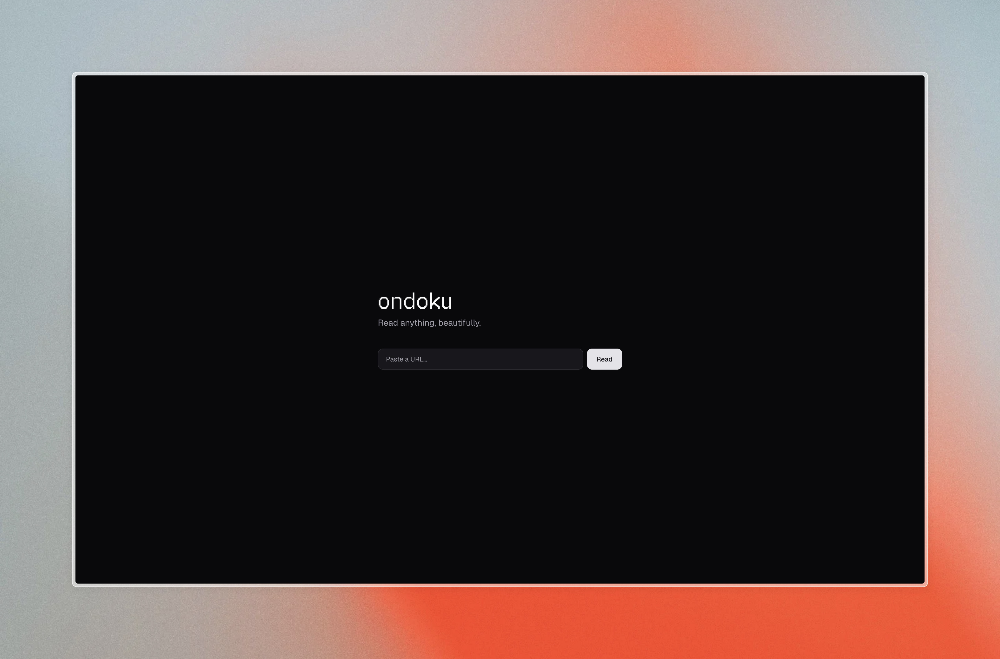

# ondoku



Read anything, beautifully — and listen to it.

Paste any article URL and ondoku strips the page to its essence: title, body, author, hero image. From there you can tune type and theme to taste, or hit play to have it read aloud with word-by-word highlighting.

The name is Japanese — *ondoku* (音読), "reading aloud."

## Features

- Clean article view, extraction powered by [defuddle](https://github.com/kepano/defuddle)
- YouTube transcripts with speaker indicators
- Text-to-speech via ElevenLabs, with word-level highlight sync
- Three themes (Dawn, Dusk, Sepia), five fonts, four sizes — persisted across visits
- Share, or copy the article as Markdown

## Getting started

```bash
pnpm install
pnpm dev
```

Then open <http://localhost:3000>.

## Environment

Read-aloud requires an [ElevenLabs](https://elevenlabs.io) account. Create a `.env.local`:

```bash
ELEVENLABS_API_KEY=your_key_here
ELEVENLABS_VOICE_ID=JBFqnCBsd6RMkjVDRZzb   # optional, overrides the default voice
```

Without a key the rest of the app still works — only the play button is inert.

## Layout

```text
app/          routes and the TTS API
components/   reader UI and hooks
lib/          fetch + extract pipeline
```
